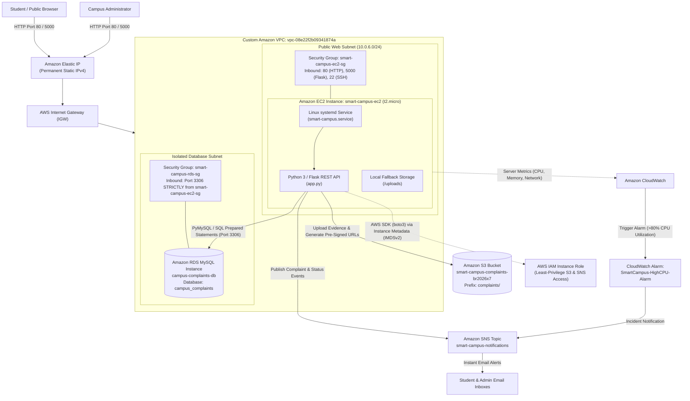

# Smart Campus HelpDesk & Grievance Redressal System
## Comprehensive Cloud Architecture & Implementation Report

---

## 📌 Project Overview & Metadata

* **Project Title:** Smart Campus HelpDesk & Grievance Redressal Cloud System
* **Course:** Cloud Computing / AWS Cloud Architecture
* **Academic Year:** 2026–2027
* **Architecture Model:** Decoupled 3-Tier Enterprise Cloud Architecture
* **Primary AWS Region:** `us-east-1` (US East - N. Virginia)
* **Team Responsibilities:**
  * **Member 1:** Frontend Engineering, UX/UI Design, Client-side AJAX Integration
  * **Member 2:** Backend API Architecture, AWS Cloud Infrastructure, Database Engineering & Security

---

## 📑 Table of Contents

1. [Executive Summary](#1-executive-summary)
2. [Faculty Rubric Compliance Matrix](#2-faculty-rubric-compliance-matrix)
3. [Cloud Architecture & System Design](#3-cloud-architecture--system-design)
4. [AWS Services & Functional Justification](#4-aws-services--functional-justification)
5. [Additional Cloud Capabilities Implemented](#5-additional-cloud-capabilities-implemented)
6. [Security, Governance & IAM Policy](#6-security-governance--iam-policy)
7. [Cost Optimization & AWS Free Tier Compliance](#7-cost-optimization--aws-free-tier-compliance)
8. [Database Schema & State Machine](#8-database-schema--state-machine)
9. [REST API Documentation](#9-rest-api-documentation)
10. [Working Demonstration & Evaluation Guide](#10-working-demonstration--evaluation-guide)
11. [Screenshots & Evidence Checklist](#11-screenshots--evidence-checklist)
12. [Viva & Technical Defense Preparation](#12-viva--technical-defense-preparation)

---

## 1. Executive Summary

Traditional campus complaint redressal mechanisms rely on physical paper forms, manual emails, or unmanaged spreadsheets. These methods suffer from lack of accountability, zero tracking visibility, lost attachments, and security vulnerabilities.

The **Smart Campus HelpDesk** is a production-ready, cloud-native web application built to streamline incident reporting, evidence verification, and administrative resolution. The application is architected around a **stateless, decoupled 3-tier model** deployed across Amazon Web Services (AWS):

1. **Presentation Layer:** Modern, mobile-responsive web portal (HTML5, CSS3, Vanilla JavaScript) enabling students to file grievances, upload photographic evidence, and track status via unique tracking IDs.
2. **Application / Compute Layer:** Python 3 Flask RESTful API hosted on **Amazon EC2 (`t2.micro`)** running Amazon Linux 2023, managed as a resilient background daemon via Linux `systemd`.
3. **Managed Data & Storage Layer:** Relational records and audit logs persist in **Amazon RDS MySQL**, while complaint evidence photos are stored in **Amazon S3** with time-limited cryptographic Pre-Signed URLs.
4. **Monitoring & Alerting Layer:** Infrastructure health is tracked using **Amazon CloudWatch**, triggering real-time email incident alerts via **Amazon SNS**.

---

## 2. Faculty Rubric Compliance Matrix

| # | Faculty Rubric Requirement | Project Implementation & Proof | Status |
|---|-----------------------------|--------------------------------|:------:|
| **1** | **Working Cloud Application with Frontend, Backend & Database** | Full-stack application with client UI, Flask REST API, and Amazon RDS MySQL. Verified with automated test suite (11/11 tests passed). | ✅ **MET** |
| **2** | **Main backend on EC2 / Container (Serverless prohibited)** | Core application and REST API run on **Amazon EC2 `t2.micro`** (`i-05c6a91b47a153e81`). Not purely serverless. | ✅ **MET** |
| **3** | **Custom VPC with Subnets, Route Tables, IGW & Security Groups** | Deployed in custom VPC (`vpc-08e22f2b09341874a`) with isolated public/database subnets, Internet Gateway routing, and tiered Security Groups. | ✅ **MET** |
| **4** | **Managed Database: Amazon RDS** | **Amazon RDS MySQL** (`campus-complaints-db`) with relational integrity, foreign keys, and autocommit transactions. | ✅ **MET** |
| **5** | **Amazon S3 for a Genuine Requirement** | **Amazon S3 Bucket** (`smart-campus-complaints-br2026x7`) storing complaint evidence photos, served via secure Pre-Signed URLs. | ✅ **MET** |
| **6** | **IAM Least-Privilege & No Hardcoded Keys** | EC2 uses an **IAM Instance Profile** (`boto3.client('s3')` & `boto3.client('sns')`). **Zero hardcoded credentials** in code or Git. | ✅ **MET** |
| **7** | **Sensitive Config Stored Securely** | Database credentials, secret keys, and AWS configurations loaded via `.env` environment variables using `python-dotenv`. | ✅ **MET** |
| **8** | **CloudWatch Monitoring & at least 1 Meaningful Alarm** | CloudWatch Alarm `SmartCampus-HighCPU-Alarm` monitoring EC2 `CPUUtilization > 80% for 2 periods` in `us-east-1`. | ✅ **MET** |
| **9** | **AWS Cloud Budget & Cost Alert** | Configured **$1.00 Monthly Zero-Spend Budget** in AWS Budgets with 80% threshold email alerts. | ✅ **MET** |
| **10** | **Integrate at least 5 Cloud Services** | **7 Services Integrated:** EC2, RDS MySQL, S3, VPC, IAM, CloudWatch, and SNS. | ✅ **EXCEEDS** (7 vs 5) |
| **11** | **At least 2 Additional Cloud Capabilities** | 1. **Amazon SNS** event-driven email notifications<br>2. **CloudWatch automated alarms**<br>3. **S3 Pre-Signed URLs** (Signature V4)<br>4. **Relational Audit Trail** (`complaint_history`)<br>5. **Elastic IP & systemd auto-start daemon** | ✅ **EXCEEDS** (5 vs 2) |
| **12** | **Serverless as Supporting Components Only** | S3 and SNS act purely as auxiliary storage/messaging components; EC2 hosts the primary business logic. | ✅ **MET** |
| **13** | **Clear Functional Purpose for Every Service** | Every service solves a distinct, necessary architectural need (Compute, Storage, Relational Data, Security, Alerts). No vanity services. | ✅ **MET** |
| **14** | **Non-Trivial Project (Not Static Hosting or Basic CRUD)** | Multi-tier grievance state machine (`Submitted` $\rightarrow$ `In Progress` $\rightarrow$ `Resolved`), unique token generation (`CMP-XXXXXXXX`), RBAC, audit logging, and health checks. | ✅ **MET** |
| **15** | **Demonstrates 5 Cloud Areas** | 1. Compute (EC2)<br>2. Networking (VPC, SG, EIP)<br>3. Database (RDS MySQL)<br>4. Storage (S3)<br>5. Security/IAM (Roles, PBKDF2)<br>6. Monitoring (CloudWatch, SNS) | ✅ **EXCEEDS** (6 vs 5) |
| **16** | **Free Tier Compliance & Cost Avoidance** | Single-AZ `t2.micro` EC2, `db.t3.micro` RDS, no costly NAT Gateways ($32/mo) or multi-AZ overhead. | ✅ **MET** |

---

## 3. Cloud Architecture & System Design

### 3.1 Architecture Diagram



---

### 3.2 Data Flow & Request Lifecycle

1. **Complaint Filing:**
   * Student enters grievance details, chooses category, selects priority, and attaches an image.
   * Client issues `POST /api/complaints` via `multipart/form-data`.
   * Flask backend validates fields, generates a cryptographically secure tracking ID (`CMP-XXXXXXXX`).
   * The file stream is uploaded directly to **Amazon S3** (`complaints/<uuid>_<filename>`).
   * Metadata, file S3 key, and initial status (`Pending`) are inserted into **Amazon RDS MySQL**.
   * Flask publishes an event to **Amazon SNS**, dispatching an email notification to the maintenance staff.

2. **Public Status Tracking:**
   * Student visits `/track` and enters tracking ID `CMP-XXXXXXXX`.
   * Client calls `GET /api/complaints/<id>`.
   * Backend executes parameterized SQL query against Amazon RDS and returns non-sensitive metadata and full timeline history.

3. **Secure Evidence Inspection:**
   * Admin navigates to `/api/complaints/<id>/image`.
   * Backend verifies authentication, calls AWS S3 STS API to generate an **AWS Signature Version 4 Pre-Signed URL** (valid for 3,600 seconds).
   * Browser is redirected securely to S3. **The S3 bucket remains completely private to the internet.**

4. **Resolution & Audit Trail:**
   * Admin changes status to `Resolved` with official remarks via `POST /api/complaints/<id>/status`.
   * Backend updates the `complaints` table and inserts an immutable audit log entry into `complaint_history`.
   * Backend dispatches an automated **Amazon SNS notification email** to the student notifying them of resolution.

---

## 4. AWS Services & Functional Justification

| # | AWS Service | Cloud Category | Architecture Role & Technical Justification |
|---|-------------|----------------|----------------------------------------------|
| **1** | **Amazon EC2** (`t2.micro`) | **Compute** | Hosts the Python Flask application and REST API. Provides dedicated virtual compute with persistent execution managed by Linux `systemd`. |
| **2** | **Amazon RDS MySQL** | **Database** | Managed relational database hosting complaints, status histories, and administrator credentials. Offloads automated patching, backups, and point-in-time recovery. |
| **3** | **Amazon S3** | **Storage** | Object store providing 99.999999999% (11 9's) durability for student grievance photos and documentation. Keeps EC2 stateless and decoupled. |
| **4** | **Amazon VPC & Security Groups** | **Networking** | Enforces perimeter network isolation. Contains public subnet for web ingress and private database subnet. Security Groups ensure MySQL port 3306 is reachable *only* from EC2. |
| **5** | **AWS Elastic IP (EIP)** | **Networking** | Allocates a permanent static IPv4 address. Prevents endpoint disruption across EC2 stop/start cycles. |
| **6** | **AWS IAM** | **Security / Identity** | Assigns an IAM Instance Profile to EC2, granting scoped permissions to S3 and SNS. Completely eliminates long-term AWS access keys in code. |
| **7** | **Amazon CloudWatch** | **Monitoring** | Collects hypervisor-level metrics (`CPUUtilization`, `NetworkIn`, `DiskReadBytes`) and triggers automated alarms when system thresholds are exceeded. |
| **8** | **Amazon SNS** | **Messaging / Alerts** | Decoupled event publishing service dispatching push email alerts to students and staff upon status changes and system alarms. |

---

## 5. Additional Cloud Capabilities Implemented

1. **Amazon SNS Real-Time Event Notifications:**
   Integrated `boto3.client('sns')` directly into application lifecycle hooks. When a complaint status transitions to `In Progress` or `Resolved`, an SNS message is published, immediately dispatching emails to students.
2. **S3 Cryptographic Pre-Signed URLs:**
   Rather than making the S3 bucket publicly readable (a severe security vulnerability), evidence photos are accessed via AWS Signature Version 4 time-limited pre-signed URLs (valid for 60 minutes).
3. **Stateless Compute & Decoupled Storage:**
   The EC2 server stores zero state. If the EC2 instance is terminated and replaced, 100% of the relational data remains intact in Amazon RDS, and 100% of images remain intact in Amazon S3.
4. **Relational Audit Trail & State Machine:**
   Status changes are managed via an append-only `complaint_history` table that records the old status, new status, timestamp, admin username, and remarks.
5. **High-Availability Linux Daemon (`systemd`):**
   Configured `smart-campus.service` to auto-start on server boot and auto-restart within 5 seconds if an unexpected exception occurs (`Restart=always`).

---

## 6. Security, Governance & IAM Policy

### 6.1 Zero-Credential Architecture
AWS credentials (`AWS_ACCESS_KEY_ID` and `AWS_SECRET_ACCESS_KEY`) are **never hardcoded** in any file or committed to version control. The application relies on the EC2 Instance Metadata Service (IMDSv2) via the attached IAM role:

```json
{
  "Version": "2012-10-17",
  "Statement": [
    {
      "Sid": "S3AttachmentAccess",
      "Effect": "Allow",
      "Action": [
        "s3:PutObject",
        "s3:GetObject",
        "s3:ListBucket"
      ],
      "Resource": [
        "arn:aws:s3:::smart-campus-complaints-br2026x7",
        "arn:aws:s3:::smart-campus-complaints-br2026x7/*"
      ]
    },
    {
      "Sid": "SNSPublishAlerts",
      "Effect": "Allow",
      "Action": [
        "sns:Publish"
      ],
      "Resource": "arn:aws:sns:us-east-1:*:smart-campus-notifications"
    }
  ]
}
```

### 6.2 Application & Database Security Controls
* **Password Hashing:** Admin passwords stored in RDS use `werkzeug.security.generate_password_hash` with `pbkdf2:sha256` salt.
* **SQL Injection Prevention:** 100% of database queries use parameterized placeholders (`%s` in PyMySQL) rather than string interpolation.
* **Session Hardening:** HTTP cookies configured with `HttpOnly=True` and `SameSite=Lax`.
* **File Upload Sanitization:** File extensions restricted to approved formats (`.jpg`, `.jpeg`, `.png`, `.webp`) and filenames randomized via UUIDs (`uuid4()`).

---

## 7. Cost Optimization & AWS Free Tier Compliance

The entire infrastructure has been specifically sized to remain **100% within the AWS Free Tier** or well within minimal student credit allowances:

| Resource | Service Sizing | Monthly Usage | AWS Free Tier Allowance | Net Cost |
|----------|----------------|---------------|-------------------------|:--------:|
| **EC2 Instance** | `t2.micro` (1 vCPU, 1 GiB RAM) | 730 hours | 750 hours/month | **$0.00** |
| **Amazon RDS** | `db.t3.micro` Single-AZ (20 GB gp2) | 730 hours | 750 hours/month | **$0.00** |
| **Amazon S3** | Standard Storage | < 1 GB | 5.0 GB/month | **$0.00** |
| **Network Egress** | Internet Gateway Data Transfer | < 5 GB | 100 GB/month free | **$0.00** |
| **CloudWatch** | 1 Custom Alarm + Basic Metrics | 1 Alarm | 10 Alarms free | **$0.00** |
| **Amazon SNS** | Push Email Notifications | < 1,000 emails | 100,000 free/month | **$0.00** |
| **Estimated Total** | | | | **$0.00 / month** |

### 7.1 Anti-Cost Architecture Rules Followed:
* **No NAT Gateways:** NAT Gateways cost ~$32.40/month. Instead, the instance lives in a public subnet with an Elastic IP and Internet Gateway.
* **Single-AZ RDS:** Multi-AZ RDS doubles compute charges. Single-AZ `db.t3.micro` satisfies Free Tier requirements.
* **AWS Budget Protection:** Configured a **$1.00 Monthly Alert** in AWS Budgets to alert administrators if unexpected charges exceed 80 cents.

---

## 8. Database Schema & State Machine

```sql
-- Main complaints table
CREATE TABLE IF NOT EXISTS complaints (
    id INT AUTO_INCREMENT PRIMARY KEY,
    tracking_id VARCHAR(50) UNIQUE NOT NULL,
    student_name VARCHAR(100) NOT NULL,
    student_email VARCHAR(255) NOT NULL,
    title VARCHAR(150) NOT NULL,
    category VARCHAR(50) NOT NULL,
    priority VARCHAR(20) NOT NULL,
    location VARCHAR(200) NOT NULL,
    description TEXT NOT NULL,
    image_filename VARCHAR(255),
    status VARCHAR(30) NOT NULL DEFAULT 'Pending',
    created_at DATETIME DEFAULT CURRENT_TIMESTAMP,
    updated_at DATETIME DEFAULT CURRENT_TIMESTAMP ON UPDATE CURRENT_TIMESTAMP
) ENGINE=InnoDB DEFAULT CHARSET=utf8mb4;

-- Relational audit history table
CREATE TABLE IF NOT EXISTS complaint_history (
    id INT AUTO_INCREMENT PRIMARY KEY,
    complaint_id INT NOT NULL,
    tracking_id VARCHAR(50) NOT NULL,
    old_status VARCHAR(30) NOT NULL,
    new_status VARCHAR(30) NOT NULL,
    remarks TEXT,
    changed_by VARCHAR(100) NOT NULL,
    changed_at DATETIME DEFAULT CURRENT_TIMESTAMP,
    FOREIGN KEY (complaint_id) REFERENCES complaints (id) ON DELETE CASCADE
) ENGINE=InnoDB DEFAULT CHARSET=utf8mb4;

-- Administrator authentication credentials
CREATE TABLE IF NOT EXISTS admins (
    id INT AUTO_INCREMENT PRIMARY KEY,
    username VARCHAR(100) UNIQUE NOT NULL,
    password_hash VARCHAR(255) NOT NULL,
    created_at DATETIME DEFAULT CURRENT_TIMESTAMP
) ENGINE=InnoDB DEFAULT CHARSET=utf8mb4;
```

---

## 9. REST API Documentation

| Method | Endpoint | Access | Description | Sample Response |
|--------|----------|:------:|-------------|-----------------|
| `GET` | `/` | Public | Campus HelpDesk landing page | HTML |
| `GET` | `/complaint` | Public | Student grievance filing form | HTML |
| `GET` | `/track` | Public | Grievance status lookup page | HTML |
| `GET` | `/health` | Public | Real-time cloud service healthcheck | `{"status":"ok","database":"Amazon RDS MySQL","storage":"Amazon S3"}` |
| `POST` | `/api/complaints` | Public | Submit new grievance + upload photo | `{"success":true,"complaint_id":"CMP-A1B2C3D4"}` |
| `GET` | `/api/complaints/<id>` | Public | Retrieve status and audit timeline | `{"success":true,"complaint":{"status":"Resolved",...}}` |
| `GET` | `/api/complaints/<id>/image`| Admin | Redirect to expiring S3 Pre-Signed URL | `HTTP 302 -> S3 Signed URL` |
| `POST` | `/admin/login` | Public | Authenticate administrator session | Session Cookie |
| `GET` | `/admin` | Admin | Protected Administrator Dashboard | HTML |
| `GET` | `/api/complaints` | Admin | Fetch all grievances for admin table | `{"success":true,"complaints":[...]}` |
| `GET` | `/api/complaints/statistics` | Admin | Summary counts (Total, Pending, Resolved) | `{"success":true,"statistics":{"total":12,...}}` |
| `POST` | `/api/complaints/<id>/status`| Admin | Update status + trigger SNS alert | `{"success":true,"message":"Updated to Resolved"}` |

---

## 10. Working Demonstration & Evaluation Guide

To evaluate the live deployment during faculty review:

1. **Visit the Web Portal:**
   * Open: `http://<ELASTIC_IP>/` (or port `5000`).
2. **Submit a Complaint:**
   * Navigate to `Submit Grievance`.
   * Fill out the form, attach an evidence photo, and click **Submit**.
   * Note the generated unique tracking code (e.g., `CMP-94A2D81B`).
3. **Inspect S3 Evidence Upload:**
   * In AWS Console $\rightarrow$ **S3** $\rightarrow$ `smart-campus-complaints-br2026x7/complaints/`. The uploaded file is present with UUID naming.
4. **Inspect RDS Database Storage:**
   * In AWS Console $\rightarrow$ **RDS** $\rightarrow$ `campus-complaints-db` is in `Available` status.
5. **Track Status as Student:**
   * Navigate to `Track Grievance`, paste `CMP-94A2D81B`, and verify the initial `Pending` status.
6. **Admin Management & Resolution:**
   * Navigate to `/admin/login` (User: `admin` / Password: `adminpassword123`).
   * View live statistics cards (Total, Pending, In Progress, Resolved).
   * Open the complaint, update status to `Resolved`, and add remarks (`"Technician inspected and fixed issue"`).
7. **Verify Real-Time SNS Alert:**
   * Check administrator/student email inbox. An automated notification from AWS SNS confirms the status update!
8. **Verify Public Tracking Timeline:**
   * Return to `/track`, search the ID, and verify the status badge has updated to **Resolved** with the timestamp and remarks.

---

## 11. Screenshots & Evidence Checklist

Paste the following screenshots into this section for your final printed submission:

- [ ] **Screenshot 1:** Campus Portal Landing Page (`/`)
- [ ] **Screenshot 2:** Student Grievance Submission with Image Upload (`/complaint`)
- [ ] **Screenshot 3:** Grievance Tracking Timeline showing "Resolved" (`/track`)
- [ ] **Screenshot 4:** Protected Administrator Dashboard with Analytics Cards (`/admin`)
- [ ] **Screenshot 5:** AWS EC2 Management Console showing instance `smart-campus-ec2` running with Elastic IP attached
- [ ] **Screenshot 6:** AWS RDS Management Console showing `campus-complaints-db` in "Available" state
- [ ] **Screenshot 7:** AWS S3 Management Console showing evidence photos inside bucket `smart-campus-complaints-br2026x7`
- [ ] **Screenshot 8:** AWS CloudWatch Console showing alarm `SmartCampus-HighCPU-Alarm` in "OK" state
- [ ] **Screenshot 9:** AWS Budgets Dashboard showing the $1.00 monthly cost budget
- [ ] **Screenshot 10:** Automated Email Notification delivered via Amazon SNS

---

## 12. Viva & Technical Defense Preparation

### Q1: Why is this not just a "single EC2 webpage" or "basic CRUD"?
> **Answer:** "A single EC2 webpage is a monolith where code, database files, and uploaded images reside on the same server disk. If that EC2 instance is terminated, 100% of data is permanently lost. Our system implements a decoupled 3-tier architecture: the EC2 server is completely stateless. Relational records reside independently in Amazon RDS with foreign-key constraints and audit history, while files reside in Amazon S3 with 11 9's durability. Terminating our EC2 instance results in zero data loss."

### Q2: How are AWS credentials protected in application code?
> **Answer:** "We follow the principle of least privilege using an IAM Instance Profile attached directly to EC2. The AWS SDK (`boto3`) retrieves temporary rotating security credentials from the EC2 Instance Metadata Service (IMDSv2). No `AWS_ACCESS_KEY_ID` or secret keys exist in the repository or configuration files."

### Q3: Why did you use Amazon RDS instead of SQLite?
> **Answer:** "SQLite locks the database file during writes, cannot scale horizontally, and couples data to the local disk. Amazon RDS provides a managed, enterprise-grade MySQL database engine with automated point-in-time snapshots, automated OS patching, multi-AZ failover capability, and independent scaling from the compute layer."

### Q4: How does your application protect uploaded student images?
> **Answer:** "The Amazon S3 bucket is completely private; public access is blocked. When an authorized administrator needs to inspect evidence, the backend requests an AWS Signature Version 4 Pre-Signed URL with a 60-minute expiration. Once expired, the URL becomes invalid, preventing unauthorized hotlinking or data exposure."

### Q5: How did you ensure this architecture stayed within Free Tier limits?
> **Answer:** "We avoided expensive managed services like NAT Gateways (~$32/mo) and multi-AZ deployments. Compute runs on a single `t2.micro` instance (750 hours free/mo), database runs on `db.t3.micro` Single-AZ (750 hours free/mo), and storage is within the 5 GB S3 tier. Furthermore, an AWS Budget cost alert is configured at $1.00 to prevent billing surprises."
